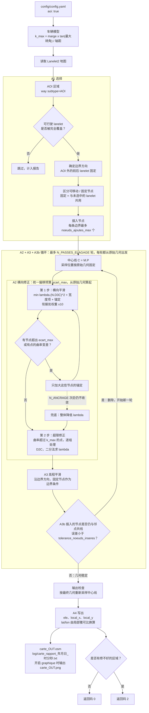

# Lanelet2 高程优化与曲率修正工具

> 法文原版：[README.md](README.md)。程序输出的报告、日志和配置注释均为法文，本文引用时保留原文。

根据实际行驶的轨迹修正 Lanelet2 地图节点的高程（`ele`），并检查路线是否符合车辆的运动学约束（最小转弯半径）。

第二种模式 `aoi: true` 不需要轨迹：直接修正地图上 AOI 区域内 lanelet 的曲率，并平滑它们的高程（见 [AOI 模式](#aoi-模式)）。

### 目录内容

| 文件 | 作用 |
|---|---|
| `optimiseur_hauteur_courbure.py` | 主脚本：读取配置，按模式调度各步骤（`traiter_trajectoire`、`traiter_aoi`、`main`）。 |
| `utils/` | 按主题划分的函数模块（见下表）。 |
| `config/config.yaml` | **全部运行参数**，每次运行都会重新读取。 |
| `config/vehicle_model.yaml` | 车队各车型的参数。 |
| `exemples/traj.csv`、`exemples/Test.osm` | 轨迹模式的示例数据。 |
| `log/` | 带时间戳的报告。 |

本目录自成一体，不依赖仓库里的其他目录。

| `utils/` 模块 | 内容 |
|---|---|
| `journal.py` | `Journal`：控制台输出和文本报告。 |
| `vehicule.py` | 读取项目格式或 Autoware 格式的车辆 YAML，`courbure_max_vehicule`。 |
| `geometrie.py` | Menger 曲率、航向、多边形判断、折线采样。 |
| `trajectoire.py` | 轨迹模式：抽稀、折返检测、重采样、高程平滑。 |
| `courbure.py` | 限制偏移量的曲率修正、二分查找、残差报告。 |
| `aoi.py` | AOI 模式：Lanelet2 拓扑、`Centrelignes`（中心线）、横向平滑与修正、边界高程平滑、插入节点、lat/lon 雅可比。 |
| `entrees_sorties.py` | CSV 和 OSM 的读写，轨迹与地图的匹配。 |
| `figures.py` | 检查用的 PNG 图。 |

### 与旧工具的关系

本工具**取代** `../optimisseur_KNN/optimiseur_hauteur_KNN.py`。旧工具仅作历史参考保留，不应再使用：它输出的高程整体错位一个采样点，而且不检查曲率（见[相对旧版本的修正](#相对旧版本的修正)）。

```
optimisation_laneletMap_axeZ/
├── optimiseur_courbure_hauteur/   <- 本工具
└── optimisseur_KNN/               <- 旧版本，已冻结
```

---

## 章节索引

- [环境要求](#环境要求)
- [快速上手](#快速上手)
- [车辆模型](#车辆模型)
- [轨迹模式处理流程](#轨迹模式处理流程)
- [AOI 模式](#aoi-模式)
- [参数](#参数)
- [输出文件](#输出文件)
- [阅读报告](#阅读报告)
- [注意事项](#注意事项)
- [VectorMap 兼容性](#vectormap-兼容性)
- [相对旧版本的修正](#相对旧版本的修正)

---

## 环境要求

Python 3.10 及以上，另需：

```bash
pip install numpy scipy pyyaml matplotlib
```

已验证的版本：Python 3.10.12、numpy 1.26.4、scipy 1.10.1、PyYAML 5.4.1、matplotlib 3.5.1。只有开启 `entrees_sorties.graphique` 时才需要 `matplotlib`。

### 输入数据

**轨迹**：带表头的 CSV，列为 `x,y,z`。允许有第 4 列 `yaw`，但会被忽略，程序会重新计算：

```csv
x,y,z,yaw
48571.61386891395,12782.825104412777,62.79046812548029,0
```

坐标必须和地图在同一个局部坐标系里（`local_x`、`local_y`）。实际中一般从 ROS 话题 `/tf`（以及 `/tf_static`）导出。

**地图**：Lanelet2 `.osm`，每个 `node` 都带有 `local_x`、`local_y` 和 `ele` 标签。

---

## 快速上手

脚本**不接受任何命令行参数**：全部参数都在 [`config/config.yaml`](config/config.yaml) 里，每次运行时重新读取。

```bash
python3 optimiseur_hauteur_courbure.py
```

`config/config.yaml` 的配置示例：

```yaml
aoi: false                      # mode trajectoire
entrees_sorties:
  carte: exemples/Test.osm
  graphique: true               # ajouter les figures de controle
mode_trajectoire:
  traj: exemples/traj.csv
vehicule:
  modele: milla_bus_l3h2        # choisir un vehicule
  lister_vehicules: true        # lister les vehicules disponibles puis quitter
```

所有键都**必须填写**。缺少某个键、键名拼错或类型不对，程序都会拒绝运行，并一次列出全部错误。`null` 表示使用默认值，默认值写在配置文件的注释里。相对路径从脚本所在目录算起，与当前工作目录无关。如果运行时带了命令行参数，程序会直接拒绝，避免让人误以为参数生效了。

典型耗时：9100 个轨迹点、28700 个地图节点约 **1.6 s**（轨迹模式）。

### 返回码

| 返回码 | 含义 |
|---|---|
| `0` | 处理完成，没有超出运动学限制的区域。 |
| `2` | 处理完成，**但**仍有车辆无法通过的弯道（详见报告）。 |
| `1` | 出错（文件不存在、格式不符、车型未知等）。 |

返回码 `2` 是为 CI 设计的：地图已经写出，但投入使用前需要人工复查。

---

## 车辆模型

曲率约束来自自行车模型：

```
R_min = empattement / tan(angle_braquage_max)
k_max = marge_courbure / R_min
```

即：最小转弯半径 = 轴距 / tan(最大转角)，曲率上限 = 曲率安全系数 / 最小转弯半径。

### 三种来源及优先级

**1. `config.yaml` 里的覆盖值**（优先级最高，覆盖车辆文件里的值）

```yaml
vehicule:
  empattement: 3.682
  angle_braquage_max: 34.38
```

**2. `config/vehicle_model.yaml`**：项目自己的格式，可以包含多个车型：

```yaml
modele_par_defaut: lohr_cristal

vehicules:
  lohr_cristal:
    description: "Lohr Cristal"
    empattement: 2.670          # [m]
    angle_braquage_max: 30.00   # [deg]
    hauteur_capteur: 0.26       # [m]
    marge_courbure: 1.0
```

**3. Autoware 原生文件**：直接指向车辆描述包里的文件，避免重复维护参数：

```yaml
vehicule:
  fichier: .../lohr_cristal_description/config/vehicle_info.param.yaml
```

程序从中读取 `wheel_base` 和 `max_steer_angle`。Autoware 的角度单位是**弧度**，程序会自动换算（0.60 rad 换算为 34.38°）。

`vehicule.fichier` 必须是文件路径。

### 当前车型

| 车型 | 轴距 | 最大转角 | 最小转弯半径 |
|---|---|---|---|
| `lohr_cristal` | 2.670 m | 30.00° | 4.62 m |
| `milla_car_l2h2` | 3.682 m | 34.38° | 5.38 m |
| `renault_master_l2h2` | 3.682 m | 34.38° | 5.38 m |
| `milla_car_l3h2` | 4.332 m | 34.38° | 6.33 m |
| `milla_bus_l3h2` | 4.332 m | 34.38° | 6.33 m |
| `renault_master_l3h2` | 4.332 m | 34.38° | 6.33 m |

`marge_courbure` 在不改动物理参数的前提下收紧约束：`0.8` 给控制器留出 20 % 的**曲率**余量。注意不是 20 % 的转角余量：以 `lohr_cristal` 为例，等效最大转角约 24.8°，而不是 30° × 0.8 = 24°。

---

## 轨迹模式处理流程

```
CSV trajectoire ─┐
                 ├─> 2. nettoyage ─> 3. reechantillonnage ─> 4. courbure ─┐
carte .osm ──────┘                                                        │
                                          5. cap  6. lissage Z <──────────┘
                                                      │
                          7. appariement KD-tree <────┘
                                                      │
                          8. ecriture carte + trajectoire + rapport
```

对应关系：2 清洗，3 重采样，4 曲率修正，5 航向，6 高程平滑，7 KD 树匹配，8 写出地图、轨迹和报告。

### 2. 清洗：最关键的一步

原始轨迹有两类缺陷，导致直接算出的曲率不可用：

- **几乎静止的点。** 车辆停车时，相邻点间距可以小到 0.4 mm，离散曲率在这里会因为除以接近 0 的数而爆掉。`mode_trajectoire.pas_min`（0.30 m）用来剔除这些点。
- **折返。** 航向在不到 1 m 内反转 180°，原因可能是倒车、多点掉头或定位跳变。折返点上的曲率没有意义。`mode_trajectoire.seuil_rebroussement`（90°）会在这些位置**把轨迹切成若干区段**，分别处理。

在参考数据上，仅这一步就把最大曲率从 **0.936（R = 1.07 m）降到 0.19（R = 5.19 m）**。检测到的折返点及其坐标会列在报告里，值得逐一核查：定位跳变意味着录制有问题。

### 3. 重采样

原始点间距从 0.4 mm 到 23 m 不等（中位数 8.65 m）。不同间距下测得的曲率没有可比性，而且 R = 5 m 的弯道弧长可能比一个采样间隔还短。因此每个区段都用以弧长为参数的三次样条重新等间距采样（`courbure.pas_reech`，1.0 m）。

附带的好处：与地图的匹配精细得多（匹配距离中位数约 1.3 m，原来约 8.6 m）。

### 4. 曲率修正

对每个 `k > k_max` 的区域，求解

```
min  Σ λᵢ ‖pᵢ₋₁ - 2pᵢ + pᵢ₊₁‖²  +  Σ ‖pᵢ - refᵢ‖²
```

这是一个带状线性方程组，直接求解；`λ` 在偏移上限 `courbure.ecart_max` 的约束下用**二分法**确定。

避开了两个陷阱，都经过实验验证：

- **不能用纯拉普拉斯平滑。** 它相当于曲线缩短流：在一段持续的弧上会把半径缩小，反而*增大*曲率。对 `ref` 的锚定项抵消了这个效应。
- **事后不做截断。** 求解后强行把点拉回偏移上限以内，会重新产生尖角，从而带来新的超限。约束体现在 `λ` 的搜索里。

如果偏移上限不够用，就在所有满足上限的平滑结果中，选**最大曲率最小**的那个，并且以未修改的区域为起点：修正永远不会让路线变差。

### 6. 高程平滑

零相位的居中滑动平均，窗口以**米**为单位（`altitude.fenetre_z`，25 m），再按 `courbure.pas_reech` 换算成采样点数。

### 7. 匹配

使用 KD 树（`scipy.spatial.cKDTree`）：每个地图节点取最近轨迹点的高程，减去 `hauteur_capteur`。节点被修改需要同时满足两个条件：最近的轨迹点在 `mode_trajectoire.distance_max` 以内，**并且**高程差达到 `mode_trajectoire.ecart_min_z`。

**受保护的元素。** 红绿灯、灯组和交通标志（`traffic_light`、`light_bulbs`、`traffic_sign`）是悬空的 linestring：它们的 `ele` 是物体本身的高度（在 `lanelet2_map.osm` 上约比路面高 2 m），不是路面高程。按距离匹配会把它们压到路面上，所以这些节点不参与修改（`mode_trajectoire.types_proteges`），报告会给出数量：

```
  noeuds proteges          : 59 (26 way(s) traffic_light/light_bulbs/traffic_sign), dont 22 retires des modifications
```

---

## AOI 模式

```yaml
aoi: true
entrees_sorties:
  carte: lanelet2_map.osm
```

不读取任何轨迹，整个 `mode_trajectoire` 部分都被忽略。直接修改的是地图本身：边界节点的**位置（`local_x`、`local_y`、`lat`、`lon`）和高程（`ele`）**。

### 总体流程图



各模块说明：

| 模块 | 作用 | 详见 |
|---|---|---|
| A1 | 决定改什么、固定什么：只有完全位于 AOI 内的 lanelet 会被修改，AOI 外的相邻 lanelet 作为边界条件。 | [AOI 区域](#aoi-区域)、[可移动节点与固定节点](#可移动节点与固定节点)、[插入节点](#插入节点) |
| A2 第 1 步 | 让曲率处处连续变化（惩罚投影到法线上的曲率导数），节点不会沿道路滑动；各项约束按节点单独满足。 | [A2](#a2-横向平滑与曲率修正)、[衔接处](#与-aoi-外道路的衔接) |
| A2 第 2 步 | 把仍然超过 `k_max` 的点在局部压回上限以内。 | [A2](#a2-横向平滑与曲率修正) |
| A3 | 沿边界方向平滑高程，不改变横坡。 | [A3](#a3-高程平滑) |
| A3b | 删除仍然无效的插入节点，然后用剩下的节点从原始几何重新计算，直到不再变化。 | [插入节点](#插入节点) |
| 输出检查 | 按最终几何重新采样，核实地图被读取时实际呈现的曲率。 | [插入节点](#插入节点) |
| A4 | 写出位置和高程，`lat/lon` 与 `local_x/local_y` 保持一致。 | [lat 与 lon](#lat-与-lon) |

偏移上限 `courbure.ecart_max` 是所有步骤**共用**的预算，从原始几何算起：后一轮不会叠加在前一轮之上，输出地图相对原始地图的偏移始终不超过 `ecart_max`。

> 流程图使用 [Mermaid](https://mermaid.js.org/) 编写：GitHub 会直接渲染；在 VS Code 的 Markdown 预览中需要安装 *Markdown Preview Mermaid Support* 插件。

### AOI 区域

即带有 `subtype=AOI` 标签的闭合 way，VectorMap Builder 生成的格式如下：

```xml
<way id="22383">
  <nd ref="22378"/> <nd ref="22382"/> <nd ref="22381"/> <nd ref="22379"/>
  <tag k="type" v="detection_area"/>
  <tag k="subtype" v="AOI"/>
  <tag k="area" v="yes"/>
</way>
```

可以同时有多个 AOI。只处理**完全被某个 AOI 覆盖**的 lanelet：两条边界的所有节点都在 AOI 内，并且没有任何一段边界穿过 AOI 的边（AOI 可以是凹多边形）。穿过或超出 AOI 的 lanelet 会计入报告（`partiellement (ignores)`），保持原样不动。`crosswalk`、`walkway`、`stairs` 类型的 lanelet 不参与处理。

### 可移动节点与固定节点

只有不属于**任何**未选中的可行驶 lanelet 的边界节点才会被移动。与地图其余部分共用的节点（与 AOI 外后继 lanelet 的连接点、与未选中的相邻车道共用的边界）保持固定，作为边界条件，保证地图连续。直接相连的前驱和后继 lanelet 也以固定状态参与计算，这样接头处的连续性也会被考虑进去（见[衔接处](#与-aoi-外道路的衔接)）。如果一条边界由两条车道共用，AOI 必须同时覆盖这两条车道，这条边界才会被修正。

### 插入节点

边界是节点稀疏的折线（节点间距约 3.9 m）：如果只移动已有节点，弯道仍然是一串尖角。`mode_aoi.noeuds_ajoutes_max: N`（0 表示不插入）允许在平滑之前，**每条边界最多插入 N 个节点**。每个新节点放在得分最高的线段中点，得分为

```
longueur × (deviation au sommet de debut + deviation au sommet de fin)
```

即：线段长度 ×（起点处的偏转角 + 终点处的偏转角）。边界两端的偏转角用前后相邻车道来计算。所以插点集中在弯道和接头处，直线段上不插。短于 `2 × courbure.pas_reech` 的线段不再切分，这自然限制了有效节点的数量（在测试区域里，效果在 N = 5 左右饱和）。

只有**完全属于**被处理 lanelet 的边界才会插点：如果边界和 AOI 外的 lanelet 共用，插点会连带改变那条 lanelet。新节点使用新的 id（从地图中最大的 id 往后编号），`lat/lon`、`local_x/local_y` 和 `ele` 都由两端插值得到，然后和其他节点一起参与平滑。新节点插在文件最后一个 `node` 之后，并写入对应 way 的 `nd` 列表。

**剪除无效节点。** 很多插入的节点在平滑之后仍然和邻点共线：它们没有任何作用，只会让地图变大。在高程平滑（A3）之后，如果一个插入的节点离两侧保留节点连线的距离小于 `mode_aoi.tolerance_noeuds_inseres`（1 cm），**平面和高程两个方向都满足**，就把它删掉。删除按贪心顺序进行（先删最贴近连线的），每删一个都会检查：两侧保留节点之间所有已删除的点，离新连线仍在容差以内。只删除插入的节点，原有节点不受影响。

**剪枝后重新优化。** A2 的各项保证（偏移预算、不新增超过 `k_max` 的点）是在剪枝*之前*的几何上检查的。所以只要剪枝删除了节点，就用剩下的节点**从原始几何出发**重新运行 A2 和 A3（新的一轮替换上一轮，而不是叠加在上面），然后再剪枝，直到某一轮不再删除任何节点（最多 `N_PASSES_ELAGAGE = 5` 轮；达到上限时，再补跑一次不剪枝的 A2 + A3）。因此写出的几何正好是最后一轮 A2 + A3 的结果，报告里有详细记录：

```
  passe 1 : 974 noeud(s) retire(s) (...), nouvelle passe A2 + A3 depuis la geometrie d'origine
  passe 2 : 8 noeud(s) retire(s) (...)
  ...
  passe 5 : 0 noeud(s) retire(s) : geometrie stable
  noeuds inseres          : 1041, dont 984 retires, 57 conserves
```

| AOI | `noeuds_ajoutes_max` | 插入 | 删除 | 保留 | 轮数 |
|---|---|---|---|---|---|
| `lanelet2_map.osm` 的 AOI | 5 | 368 | 321 | 47 | 3 |
| `lanelet2_map.osm` 的 AOI | 300 | 1041 | 984 | 57 | 5 |
| 测试区域 G | 300 | 42 | 23 | 19 | 2 |

节点变少后重新优化，可能又让几个节点变成无效节点，所以会有后续几轮。最大曲率、超限点数和 `|dk/ds|` 与剪枝前的稠密结果相当；在一个测试区域里，衔接处的折角从 17.7° 变为 19.4°（保留 14 个节点，而不是 20 个）。`tolerance_noeuds_inseres: 0` 关闭剪枝（只跑一轮）。

**输出检查。** 为了让问题保持线性，A2 的中心线采样位置是按原始几何的比例固定的；而 Autoware 加载地图时会按地图的实际几何重新采样。所以处理结束时，会按最终几何重新采样，重新计算曲率，并与 A2 的结果比较（实测差异在千分之几 1/m）：

```
  k max 0.1984 1/m (A2 : 0.2002), points en exces 24 (A2 : 24), |dk/ds| max 0.0497 1/m2
```

如果这项检查发现的超限点比 A2 报告的多，会给出警告。

### A2 横向平滑与曲率修正

每条 lanelet 的中心线以 `courbure.pas_reech` 为间距，按左右两条边界长度的相同比例采样（与 Autoware 的 `generateFineCenterline` 构造方式相同）。每个采样点都是边界节点的固定线性组合（`C = M·P`），`L = M_l·P` 是左边界到右边界的向量。优化变量是**节点** `X`，而不是采样点。分两步进行，共用**统一的偏移预算** `courbure.ecart_max`，从原始几何算起：这是输出地图相对原始地图偏移量的硬上限，与内部分了几步无关。报告会分别列出每一步的占用：

```
  deplacement max par etape   : lissage 0.268 m, corrections 0.119 m ; cumule 0.294 m (budget commun 0.30 m)
```

**第 1 步：全局横向平滑**。作用于所有被选中的 lanelet，不管它们是否超过 `k_max`，目的是让曲率**连续变化**：

```
min  λ Σ (N⁰·Δ³C)²  +  λ μ₁ Σ ‖L - L⁰‖²  +  Σ aᵢ ‖Xᵢ - X⁰ᵢ‖²,     λ = (fenetre / 2π·pas)⁶
```

`N⁰·Δ³C` 是中心线三阶导数**在法线方向上的投影**，也就是曲率的导数 `k'`：惩罚的是曲率的跳变，而不是曲率本身。它按原始几何上的弧长用**差商**计算，法线 `N⁰` 按原始几何固定（问题仍然是线性的）。

为什么不直接用三阶差分 `Δ³C = C₃ - 3C₂ + 3C₁ - C₀`：它假设采样点等间距，但实际并不等间距（每条 lanelet 的间距不同，左右边界形状也不同），于是即使是直线，它的值也不为零，而且方向**沿着**道路。另外 `d³r/ds³ = k'·N - k²·T`，切向分量并不反映曲率变化。惩罚它会让节点沿边界滑动：在 `lanelet2_map.osm` 的 AOI 上，接近一半的位移是这种滑动，最大 0.24 m，占用了偏移预算却没有起到平滑作用。改用法向投影后，沿边界方向的位移最多 0.05 m，曲率和 `|dk/ds|` 基本不变。第 2 步仍然按坐标分量使用二阶差分（改成法向投影后，路口的修正效果变差）；所以在路口里，仍有一部分位移是沿道路方向的。

`mode_aoi.fenetre_laterale`（10 m）是滤波器的截止波长。偏移预算**按节点**单独满足：只加大超出预算的那些节点的锚定权重 `aᵢ`，反复迭代，不会因为一个受限的节点而削弱整个 AOI 的平滑。报告给出平滑前后的 `|dk/ds|`（最大值和第 95 百分位）。

在三个测试区域里，10 m 是最好的折中：`|dk/ds|` 的第 95 百分位降低 25 % 到 30 %，平均位移约 6 cm；用 20 m 时，一半节点会碰到预算上限，效果反而更差。

**第 2 步：超限的局部修正**。针对平滑后仍然 `k > k_max` 的地方，形式与轨迹模式相同（二阶差分，以超限点为中心的钟形权重，`λ` 用二分法确定）：

```
min  λ Σ wᵢ ‖Δ²C‖²  +  λ μ₂ Σ wᵢ ‖L - L⁰‖²  +  Σ ‖X - X_dep‖²
```

宽度项（`μ₁ = POIDS_LARGEUR_LISSAGE = 1.0`，`μ₂ = POIDS_LARGEUR = 0.3`）防止两条对向车道共用的边界为了迁就两边的中心线而变形：没有这一项时车道宽度最多偏 0.18 m，有了之后为 0.04 m。

横向平滑不能让曲率变差：把一个峰值摊开时，可能会抬高另一处。这条约束和偏移预算一样**局部生效**：任何中心线采样点，只要最终曲率既超过 `k_max` *又*高于它原来的曲率，就锚定它所依赖的节点，反复迭代；区域内其他地方照常充分平滑。报告分别给出因两种原因被锚定的节点数：

```
  lissage lateral         : fenetre 10.0 m, noeuds ancres : 23 par le budget d'ecart, 12 pour ne pas aggraver la courbure
```

早先的一个版本只要有一处变差，就降低**整个** AOI 的 `λ`：在 `lanelet2_map.osm` 的 AOI 上（有一个路口，24 个超限点无法修正），平滑几乎被完全取消（最大位移 3 cm，只有 180 个节点移动超过 5 mm）。改为局部锚定后：719 个节点被移动，`|dk/ds|` 最大值从 0.0497 降到 0.0386 1/m²，衔接处最大折角从 4.7° 降到 1.2°，最大曲率和超限点数不变。全局降低只在局部锚定不收敛时作为兜底（报告中会出现 `ancrage local non converge` 警告）。

在无法修好的路口，代价是：横向平滑占用了统一预算的一部分，第 2 步在那里的余量变少。曾经试过*按步骤分别计算*预算（每一步从自己的起点重新计算），后来放弃了：它相当于允许总偏移超过 `ecart_max`（最多为 步骤数 × `ecart_max`），而参数本身看不出这一点。在总位移相同的情况下，统一预算的效果相同或更好：

| 测试区域 G | 最大位移 | 最大曲率 | 超限点 | `\|dk/ds\|` 最大值 | 折角 |
|---|---|---|---|---|---|
| 统一预算，`ecart_max: 0.30` | 0.294 m | 0.226 | 5 | 0.093 | 10.7° |
| 按步骤计算，0.30（已放弃） | 0.382 m | 0.211 | 3 | 0.094 | 11.3° |
| 统一预算，`ecart_max: 0.45` | 0.415 m | 0.211 | 3 | 0.089 | 10.3° |

如果某个路口余量不够，就调大 `ecart_max`：偏移量仍然有保证。

`mode_aoi.sans_lissage_lateral` 关闭第 1 步，`courbure.sans_courbure` 关闭第 2 步。

### 与 AOI 外道路的衔接

被处理 lanelet 的两端与 AOI 外的前驱、后继共用节点：这些节点保持不动（位置连续），这些固定的邻居作为边界条件参与计算。**跨越衔接处**的三阶差分项权重为 `POIDS_RACCORD = 10`：修正后的中心线必须延续相邻道路的切线和曲率。报告给出衔接处中心线的折角和 `|dk/ds|` 的前后对比：

```
  raccords aux voisins figes  : 5, cassure max 23.50 -> 9.18 deg, |dk/ds| max 0.1502 -> 0.1274 1/m2
```

三个测试区域衔接处的最大折角：

| 区域 | 原始 | 不插点 | `noeuds_ajoutes_max: 5` |
|---|---|---|---|
| F | 23.5° | 21.1° | 9.2° |
| G | 26.2° | 19.0° | 13.4° |
| H | 17.8° | 13.2° | 6.3° |

剩余的折角来自固定的相邻道路本身：如果 AOI 外的道路进入连接点时已经带着角度，只有把 AOI 画大才能消除。

**曲率的计算方式。** 边界是折线（节点间距中位数约 3.9 m，顶点处的转角可达 30°）：如果用 1 m 的基线计算 Menger 曲率，每个顶点都会被当成急弯。所以曲率用间隔为 `± mode_aoi.base_courbure` 的三点计算，默认值为车辆**轴距**。在 `lanelet2_map.osm` 上，`road` 类型 lanelet 中超限的数量，基线 1 m 时为 94 条，3 m 时为 46 条；基线直接影响结果。

### A3 高程平滑

不做重新匹配：对已有高程**沿边界方向**平滑（从不跨越车道方向，横坡保持不变），求解

```
min  Σ mᵢ (zᵢ - z⁰ᵢ)²  +  ℓ² Σ₍ᵢⱼ₎ (zᵢ - zⱼ)² / dᵢⱼ ,   ℓ = fenetre / √24
```

它是指数核平滑的离散形式，其方差与宽度为 `altitude.fenetre_z` 的滑动平均相同。固定节点保持原高程：AOI 边界处不会出现台阶。`mode_trajectoire.offset_capteur`、`mode_trajectoire.distance_max` 和 `mode_trajectoire.ecart_min_z` 不起作用。

### lat 与 lon

程序并不知道地图的投影方式。`lat/lon` 的变化量由局部雅可比矩阵 `d(lat,lon)/d(x,y)` 换算，该矩阵在被处理的边界节点上用最小二乘拟合（典型残差约 1 mm）；`lat/lon` 与 `local_x/local_y` 对不上的节点会被排除在拟合之外。

### 已知局限：路口转弯

路口左转、右转的 lanelet，曲率往往**无论 `courbure.ecart_max` 设多大都修不好**：它们的两端是与直行 lanelet 共用的分叉点，起点的位置和切线方向都被固定了。要加大转弯半径，就得把这些连接点往后挪。这些区域会列在报告里（`lanelets` 列），并给出返回码 2：需要重新绘制路口。

---

## 参数

全部在 [`config/config.yaml`](config/config.yaml) 中，下表为发布时的取值。文件把参数分为两种模式**共用**的、**AOI 模式**专用的（`mode_aoi`）和**轨迹模式**专用的（`mode_trajectoire`，在 AOI 模式下不起作用）。

### `aoi`

| 键 | 取值 | 作用 |
|---|---|---|
| `aoi` | `true` | `true`：AOI 模式，直接修正完全被 AOI 覆盖的 lanelet。`false`：轨迹模式。 |

### 共用：`entrees_sorties`

| 键 | 取值 | 作用 |
|---|---|---|
| `carte` | `lanelet2_map.osm` | Lanelet2 地图。 |
| `sortie_carte` | `null`：`<carte>_OUT.osm` | 输出地图。 |
| `rapport` | `null`：`log/<carte>_rapport_<AAAAMMJJ_HHMMSS>.txt` | 文本报告，总是带时间戳（指定路径时同样会加时间戳）。 |
| `graphique` | `false` | 输出 PNG 图。 |
| `silencieux` | `false` | 不在控制台输出（报告照常写出）。 |

### 共用：`vehicule`

| 键 | 取值 | 作用 |
|---|---|---|
| `fichier` | `config/vehicle_model.yaml` | 车型文件，或 Autoware 的 `vehicle_info.param.yaml`。 |
| `modele` | `null`：`modele_par_defaut` | 使用的车型。 |
| `lister_vehicules` | `false` | 列出车型后退出。 |
| `empattement` | `null`：取车辆文件的值 | 轴距（m）。 |
| `angle_braquage_max` | `null`：取车辆文件的值 | 前轮最大转角（°）。 |
| `marge_courbure` | `null`：取车辆文件的值 | 曲率安全系数（`<1` 表示更严格）。 |

### 共用：`courbure`

| 键 | 取值 | 作用 |
|---|---|---|
| `ecart_max` | 0.30 m | 轨迹点（轨迹模式）或节点（AOI 模式）的最大横向位移，从原始几何算起；在 AOI 模式下由两步共用。 |
| `pas_reech` | 1.0 m | 轨迹 / 中心线的重采样间距。 |
| `sans_courbure` | `false` | 关闭第 4 步（AOI 模式下为 A2 第 2 步）。 |

### 共用：`altitude`

| 键 | 取值 | 作用 |
|---|---|---|
| `fenetre_z` | 25.0 m | 平滑窗口。 |
| `sans_lissage_z` | `false` | 关闭平滑。 |
| `precision` | 4 | 写入 `ele`、`local_x`、`local_y` 的小数位数。 |

### AOI 模式：`mode_aoi`

| 键 | 取值 | 作用 |
|---|---|---|
| `base_courbure` | `null`：轴距 | 中心线曲率测量的半基线（m）。 |
| `fenetre_laterale` | 10.0 m | 横向平滑的截止波长。 |
| `sans_lissage_lateral` | `false` | 关闭横向平滑（A2 第 1 步）。 |
| `noeuds_ajoutes_max` | 1 | 每条边界最多插入的节点数（0 表示不插入）。 |
| `tolerance_noeuds_inseres` | 0.01 m | 插入的节点在平面和高程上离邻点连线都小于该距离时被删除（0 表示不剪枝）。 |

### 轨迹模式：`mode_trajectoire`

两种模式下都会读取和校验，但**在 AOI 模式下不起作用**。

| 键 | 取值 | 作用 |
|---|---|---|
| `traj` | `exemples/traj.csv` | 轨迹 CSV。 |
| `sortie_traj` | `null`：`<traj>_OUT.csv` | 修正后的轨迹。 |
| `pas_min` | 0.30 m | 保留的原始点之间的最小距离。 |
| `seuil_rebroussement` | 90° | 航向变化超过该值时切分轨迹。 |
| `distance_max` | 12.0 m | 最大匹配半径。 |
| `ecart_min_z` | 0.20 m | 高程差小于该值时不修改节点。 |
| `offset_capteur` | `null`：车型的 `hauteur_capteur` | 从 Z 中减去的高度（m）。 |
| `ele_nul_mediane` | `false` | 给 `ele=0` 且无匹配的节点填入中位高程。 |
| `types_proteges` | `[traffic_light, light_bulbs, traffic_sign]` | 这些类型的 way 的节点永远不修改（`[]` 表示不保护）。 |

算法内部常量（`LAMBDA_*`、`POIDS_LARGEUR*`、`POIDS_RACCORD`、`N_ANCRAGE` 等）保留在 `utils/courbure.py` 和 `utils/aoi.py` 中。

---

## 输出文件

| 文件 | 内容 |
|---|---|
| `<carte>_OUT.osm` | Lanelet2 地图。轨迹模式下**只修改 `ele` 标签**；几何、way、relation 和其他标签原样保留。 |
| `<traj>_OUT.csv` | 清洗、重采样、修正后的轨迹，`yaw` 重新计算。 |
| `log/<carte>_rapport_<AAAAMMJJ_HHMMSS>.txt` | 完整日志（与控制台输出相同），带时间戳：新的运行不会覆盖之前的报告。 |
| `<carte>_OUT.png` | 开启 `entrees_sorties.graphique` 时输出：原始高程、平滑后高程、曲率与上限对比。AOI 模式下为：修改前后的平面图、中心线曲率、可移动节点的高程。 |

AOI 模式下没有 `<traj>_OUT.csv`；`<carte>_OUT.osm` 还包含被移动节点的新位置（`local_x`、`local_y`、`lat`、`lon`）。

---

## 阅读报告

需要重点看第 4 步的输出：

```
  points en exces de courbure : 42 -> 32

  /!\ 3 zone(s) NON corrigeables dans le budget d'ecart :
      x              y              R reel(m)  k(1/m)     braquage requis
      56271.40       15584.99       5.42       0.1846     38.7 deg
```

解读：该处路线要求 5.42 m 的转弯半径，即需要 **38.7° 的转角**，而所选车辆最多只有 34.38°。三种处理方式：

1. **调大 `courbure.ecart_max`**（如果车道条件允许）。注意：如果实际用掉的横向位移远小于上限（看 `deplacement lateral` 那一行），说明限制不在预算而在几何本身，调大上限不会有任何变化。
2. **在这些坐标处重新绘制地图。**
3. **为这条线路分配轴距更短的车辆。**

---

## 注意事项

### `hauteur_capteur` 未经核实

`0.26` m 是从旧脚本原样沿用的，并且用于所有车型。**没有在任何一辆车上核实过。** Autoware 的 `vehicle_info.param.yaml` 里也没有这个参数。

它表示记录轨迹所用坐标系离地面的高度。如果用的是 `base_link`，且 `base_link` 位于地面高度，正确值应为 `0.0`，否则整张地图的高程都会偏 26 cm。**投入使用前必须实测。**

### 轨迹覆盖不全

只有距离轨迹点 `mode_trajectoire.distance_max` 以内的节点会被重新赋高程（参考数据上约 50 %：轨迹只覆盖实际走过的车道）。其余节点保持原高程。报告中 `noeuds avec voisin` 一行给出覆盖率。

### `mode_trajectoire.ele_nul_mediane`

给仍为 `ele = 0` 且没有匹配的节点填入轨迹高程的中位数。这只是很粗糙的补救：在地形起伏明显的地图上，全局中位数在局部没有意义。默认关闭。

---

## VectorMap 兼容性

标签按**键名**读取，不依赖顺序，所以格式变体和可选标签（`color`、`mgrs_code` 等）都不受影响。

2024 年 10 月之后的格式：

```xml
<node id="1" lat="46.12982337722" lon="-1.0794278177">
  <tag k="local_x" v="48365.1015"/>
  <tag k="local_y" v="10264.8907"/>
  <tag k="ele" v="53.9878"/>
</node>
```

2024 年 8 月的格式（`mgrs_code` 在最前面）：

```xml
<node id="48" lat="48.72244562283628" lon="2.257069031480778">
  <tag k="mgrs_code" v="31UDP453968"/>
  <tag k="local_x" v="45359.0525"/>
  <tag k="local_y" v="96868.3611"/>
  <tag k="ele" v="129.5001"/>
</node>
```

两种格式都支持。缺少 `local_x` / `local_y` / `ele` 的节点会被跳过，并计入报告。

---

## 相对旧版本的修正

`../optimisseur_KNN/optimiseur_hauteur_KNN.py` 存在以下问题，均已修正：

| 问题 | 后果 | 修正 |
|---|---|---|
| `np.convolve(..., 'full')` 之后截取错误 | 平滑后的高程**整体错位一个采样点** | 边界填充 + `valid` 模式；内部误差验证为 3e-14 |
| 用 Python 循环做最近邻搜索，复杂度 `O(N*M)` | 2.6e8 次距离计算约 48 s | KD 树：整条流程约 1.6 s |
| 按位置读取标签（`node[0]`、`node[1]`、`node[2]`） | 在 2024 年 8 月格式上读错且无任何提示 | 按键名读取 |
| 硬编码绝对路径（`/home/admin01/...`） | 脚本无法直接使用 | `config/config.yaml`，路径相对于脚本 |
| 写入时用 `str(float)` | `ele` 有 17 位小数 | `altitude.precision`（默认 4 位） |
| `plt.show()` 阻塞 | 没有显示器时无法使用 | `Agg` 后端，PNG 可选 |
| 标题和坐标轴标签在 `plt.subplot` 之前设置 | 作用在一个看不见的坐标轴上 | 用 `subplots` 创建图 |
| 只有开启过滤时才计算 `z_median` | `ele=0` 的节点被写成 0 | 始终计算中位数，并设显式开关 |
| 从不检查曲率 | 无法保证路线可以行驶 | 第 2 到 4 步 |
| 常量硬编码（`-0.26`、`max_distance`、`min_dega`） | 无法调整 | 车辆模型 + 配置参数 |
